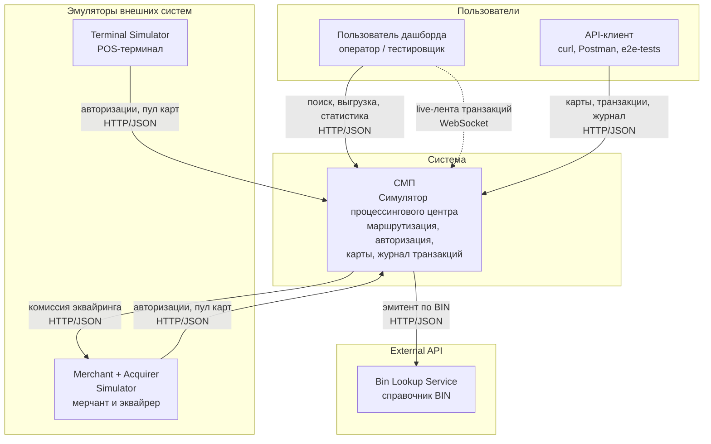

# А1. C4 Level 1 — Context

## Чего не хватало в проекте

В [`docs/architecture.md`](../../architecture.md) есть только общая схема, где
симуляторы, сервисы СМП, инфраструктура и dashboard нарисованы на одном уровне.
Граница «СМП - внешний мир» не проведена, не указано, по какому протоколу входит
каждый актор.

## Что сделано

- СМП нарисована как чёрный ящик, снаружи — акторы, которые с ней
  взаимодействуют.
- На стрелках указаны назначение взаимодействия и протокол.

## Диаграмма

| src                      | dest                | Протокол / endpoint                         | код                                                                                                                                                                                                                                                                                                                    |
|--------------------------|---------------------|---------------------------------------------|------------------------------------------------------------------------------------------------------------------------------------------------------------------------------------------------------------------------------------------------------------------------------------------------------------------------|
| Terminal Simulator       | СМП                 | `POST {GATEWAY_URL}/api/transactions`       | [`terminal-simulator/.../client/GatewayClient.java:30`](../../../services/terminal-simulator/src/main/java/com/processing/terminalsimulator/client/GatewayClient.java)                                                                                                                                             |
| Terminal Simulator       | СМП (мимо Gateway)  | `GET {CARD_MGMT_URL}/api/cards`             | [`GatewayClient.java:35`](../../../services/terminal-simulator/src/main/java/com/processing/terminalsimulator/client/GatewayClient.java), `CARD_MGMT_URL` в [`docker-compose.yaml`](../../../docker-compose.yaml)                                                                                                  |
| Merchant + Acquirer      | СМП                 | `GET /api/cards`, `POST /api/transactions`  | [`merchant-acquirer/.../client/GatewayClient.java:60,92`](../../../services/merchant-acquirer/src/main/java/com/processing/merchantacquirer/client/GatewayClient.java)                                                                                                                                             |
| СМП                      | Merchant + Acquirer | `POST /api/simulator/merchant/fee`          | [`switch/.../MerchantAcquirerClient.java:48`](../../../services/switch/src/main/java/com/processing/service/MerchantAcquirerClient.java)                                                                                                                                                                           |
| Пользователь дашборда    | СМП                 | nginx: `/api/` to Gateway, `/ws/` to Logger | [`dashboard/nginx.conf:22,29`](../../../services/dashboard/nginx.conf)                                                                                                                                                                                                                                             |
| API-клиент / тестировщик | СМП                 | Gateway `:8080`, маршруты                   | [`gateway/.../application.yml:65-105`](../../../services/gateway/src/main/resources/application.yml)                                                                                                                                                                                                               |
| СМП                      | BIN Lookup          | `GET /api/bin/{bin}?delay=&fail=`           | [`authorization/.../BinLookupClient.java:59`](../../../services/authorization/src/main/java/com/processing/authorization/client/BinLookupClient.java), [`bin-lookup/.../BinLookupController.java:38`](../../../services/bin-lookup/src/main/java/com/processing/binlookup/controller/BinLookupController.java) |
