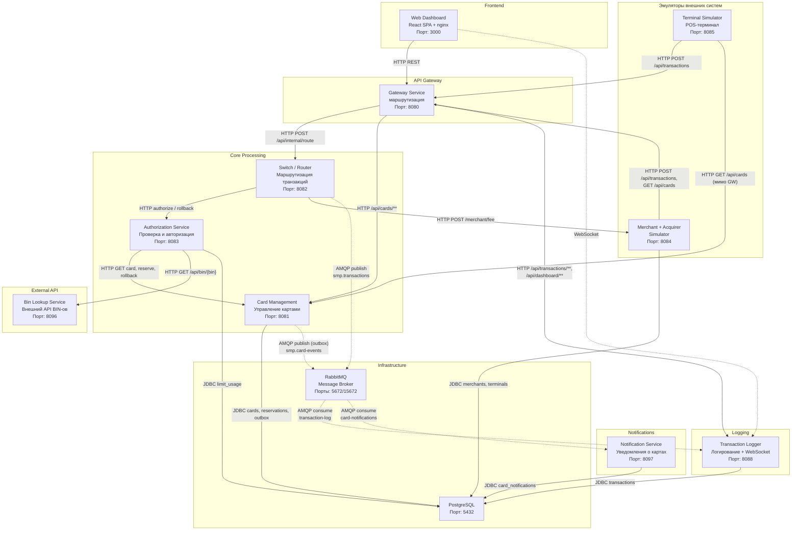

# А2. C4 Level 2 — Container

## Чего не хватало в проекте

| # | Что в документации                                                   | Что в коде                                                                                                                                               | Ссылка                                                                                                                                                                                                                                              |
|---|----------------------------------------------------------------------|----------------------------------------------------------------------------------------------------------------------------------------------------------|-----------------------------------------------------------------------------------------------------------------------------------------------------------------------------------------------------------------------------------------------------|
| 1 | Все стрелки одинаковые, sync и async не различаются                  | Есть три типа связи: HTTP, JDBC, AMQP                                                                                                                    | —                                                                                                                                                                                                                                                   |
| 2 | Нет связи Switch - Merchant Acquirer                                 | Switch синхронно запрашивает комиссию у Merchant Acquirer после каждой авторизации                                                                       | [`RouteService.java:70`](../../../services/switch/src/main/java/com/processing/service/RouteService.java)                                                                                                                                           |
| 3 | Terminal Simulator ходит только Gateway                              | `GET /api/cards` напрямую в Card Management                                                                                                              | [`GatewayClient.java:35`](../../../services/terminal-simulator/src/main/java/com/processing/terminalsimulator/client/GatewayClient.java)                                                                                                            |
| 4 | Merchant Acquirer без БД                                             | У Merchant Acquirer свои таблицы (merchants, terminals, acquirer_fee)                                                                                    | [`merchant-acquirer/.../db/migration`](../../../services/merchant-acquirer/src/main/resources/db/migration)                                                                                                                                         |
| 5 | Gateway to Logger не показан                                         | Gateway проксирует `GET /api/transactions/**` и `/api/dashboard/**` в Logger                                                                             | [`gateway application.yml:74-85`](../../../services/gateway/src/main/resources/application.yml)                                                                                                                                                     |

## Что сделано

- Схема сверена с `docker-compose.yaml`: 11 сервисов (9 Java-сервисов,
  dashboard и autoscaler), PostgreSQL, RabbitMQ. На схему не вынесены
  autoscaler (профиль `observability`, масштабирует terminal-simulator по RPS
  Gateway) и Prometheus/Grafana/Loki/Promtail: в обработке транзакций они не
  участвуют.
- Размечены: **сплошная** — синхронный вызов, **пунктир** — асинхронный.
- Добавлены пропущенные связи (Switch to Merchant, Terminal to CMS, Gateway to Logger).
- На стрелки схемы вынесена топология RabbitMQ, которая в
  `docs/architecture.md` есть только в таблице «Сводная топология RabbitMQ»: у каждой публикации подписан
  exchange (`smp.transactions`, `smp.card-events`), у каждого потребления —
  очередь (`transaction-log`, `card-notifications`).
- У Notification Service есть endpoint на чтение `GET /api/notifications`
  ([`NotificationController.java`](../../../services/notification-service/src/main/java/com/processing/notification/controller/NotificationController.java)).
  В Gateway маршрута на него нет, поэтому уведомления читаются только напрямую
  по порту `:8097`.

## Диаграмма

## Таблица связей

| #  | src           | dest                     | Тип        | Детали                                                                      | Код                                                                                                                                                                                                                                                                                                                  |
|----|---------------|--------------------------|------------|-----------------------------------------------------------------------------|----------------------------------------------------------------------------------------------------------------------------------------------------------------------------------------------------------------------------------------------------------------------------------------------------------------------|
| 1  | Gateway       | Switch                   | sync HTTP  | `/api/transactions` переписывается в `/api/internal/route`                  | [`gateway application.yml:73`](../../../services/gateway/src/main/resources/application.yml), [`RouteController.java:44`](../../../services/switch/src/main/java/com/processing/controller/RouteController.java)                                                                                                     |
| 2  | Gateway       | CMS                      | sync HTTP  | кеш GET на 5 мин, сброс при не-GET через Gateway                            | [`BeanConfiguration.java:30`](../../../services/gateway/src/main/java/com/processing/gateway/config/BeanConfiguration.java), [`ResponseCachingGatewayFilterFactory.java:49`](../../../services/gateway/src/main/java/com/processing/gateway/caching/ResponseCachingGatewayFilterFactory.java)                        |
| 3  | Switch        | Authorization            | sync HTTP  | Resilience4j: CB + retry 3 попытки, backoff 1s/2s/4s, read timeout 5s       | [`AuthorizationClient.java:58-59,78`](../../../services/switch/src/main/java/com/processing/service/AuthorizationClient.java), [`application.yml:24`](../../../services/switch/src/main/resources/application.yml)                                                                                                   |
| 4  | Switch        | Authorization (rollback) | sync HTTP  | без retry, ошибка - `null`                                                  | [`AuthorizationClient.java:103`](../../../services/switch/src/main/java/com/processing/service/AuthorizationClient.java)                                                                                                                                                                                             |
| 5  | Switch        | Merchant                 | sync HTTP  | ошибка - комиссия `null`, транзакция продолжается                           | [`MerchantAcquirerClient.java:48`](../../../services/switch/src/main/java/com/processing/service/MerchantAcquirerClient.java)                                                                                                                                                                                        |
| 6  | Switch        | RabbitMQ                 | async AMQP | `convertAndSend` в `smp.transactions`, Java-сериализация                    | [`LoggerClient.java:40`](../../../services/switch/src/main/java/com/processing/service/LoggerClient.java)                                                                                                                                                                                                            |
| 7  | Authorization | CMS                      | sync HTTP  | GET карты, reserve, rollback; маппинг 400/402/404/409/500/503 в исключения  | [`CardManagementClientImpl.java`](../../../services/authorization/src/main/java/com/processing/authorization/client/CardManagementClientImpl.java)                                                                                                                                                                   |
| 8  | Authorization | Bin Lookup               | sync HTTP  | любые ошибки гасятся, результат не используется в решении                   | [`BinLookupClient.java:59,65`](../../../services/authorization/src/main/java/com/processing/authorization/client/BinLookupClient.java)                                                                                                                                                                               |
| 9  | Authorization | PostgreSQL               | sync JDBC  | атомарный upsert лимитов, блок RRN из `rrn_seq`                             | [`LimitUsageRepository.java:89,118`](../../../services/authorization/src/main/java/com/processing/authorization/repositories/LimitUsageRepository.java)                                                                                                                                                              |
| 10 | CMS           | PostgreSQL               | sync JDBC  | `SELECT … FOR UPDATE` на карту при reserve/rollback/patch                   | [`CardJpaRepository.java:20-21`](../../../services/card-management/src/main/java/com/processing/cardmanagement/repositories/CardJpaRepository.java)                                                                                                                                                                  |
| 11 | CMS           | RabbitMQ                 | async AMQP | outbox: запись в `outbox_event` в транзакции, публикация поллером раз в 1s  | [`CardEventNotifierImpl.java:17`](../../../services/card-management/src/main/java/com/processing/cardmanagement/events/CardEventNotifierImpl.java), [`OutboxProcessor.java:21`](../../../services/card-management/src/main/java/com/processing/cardmanagement/services/OutboxProcessor.java)                         |
| 12 | RabbitMQ      | Logger                   | async AMQP | `@RabbitListener(transaction-log)` -> `saveAndFlush` -> WebSocket broadcast | [`TransactionLogListener.java:27`](../../../services/transaction-logger/src/main/java/com/processing/transactionlogger/listener/TransactionLogListener.java), [`TransactionService.java:79,91`](../../../services/transaction-logger/src/main/java/com/processing/transactionlogger/service/TransactionService.java) |
| 13 | RabbitMQ      | Notification             | async AMQP |                                                                             | [`CardEventListener.java:36`](../../../services/notification-service/src/main/java/com/processing/notification/listener/CardEventListener.java)                                                                                                                                                                      |