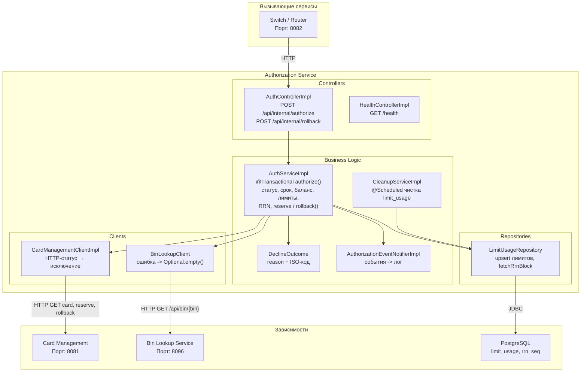
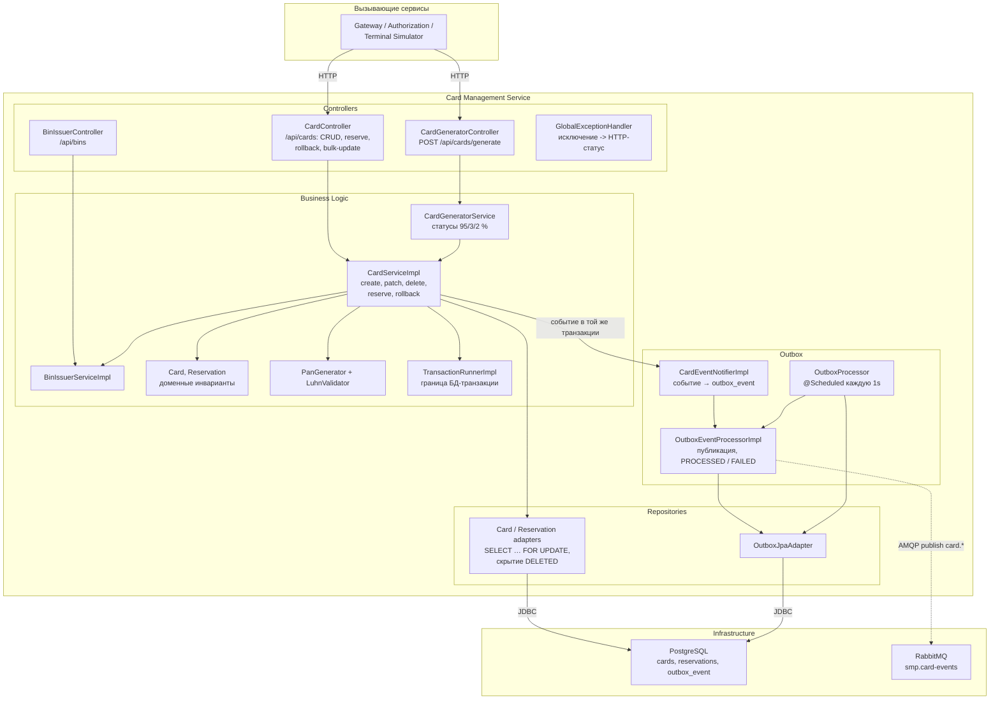

# А3. C4 Level 3 — Component (Authorization, Card-Management)

## Что сделано

Схемы собраны по пакетам
[`services/authorization/.../authorization`](../../../services/authorization/src/main/java/com/processing/authorization/)
и [`services/card-management/.../cardmanagement`](../../../services/card-management/src/main/java/com/processing/cardmanagement/).
Для каждого компонента указан тип зависимости: HTTP-клиент, JPA-репозиторий, AMQP.

---

## А3.1 Authorization

| Компонент                        | Роль                                             | Код                                                                                                                                                 |
|----------------------------------|--------------------------------------------------|-----------------------------------------------------------------------------------------------------------------------------------------------------|
| `AuthControllerImpl`             | REST, маппинг `declineReason` → HTTP-статус      | [`AuthControllerImpl.java:38,76,90`](../../../services/authorization/src/main/java/com/processing/authorization/controller/AuthControllerImpl.java) |
| `AuthServiceImpl`                | вся бизнес-логика авторизации и отката           | [`AuthServiceImpl.java:42-185`](../../../services/authorization/src/main/java/com/processing/authorization/services/AuthServiceImpl.java)           |
| `DeclineOutcome`                 | таблица «причина → код»                          | [`DeclineOutcome.java`](../../../services/authorization/src/main/java/com/processing/authorization/constants/DeclineOutcome.java)                   |
| `CardManagementClientImpl`       | HTTP к CMS, 400/402/404/409/500/503 → исключения | [`CardManagementClientImpl.java`](../../../services/authorization/src/main/java/com/processing/authorization/client/CardManagementClientImpl.java)  |
| `BinLookupClient`                | HTTP к Bin Lookup, graceful degradation          | [`BinLookupClient.java:59`](../../../services/authorization/src/main/java/com/processing/authorization/client/BinLookupClient.java)                 |
| `LimitUsageRepository`           | атомарный SQL-upsert лимитов                     | [`LimitUsageRepository.java:89`](../../../services/authorization/src/main/java/com/processing/authorization/repositories/LimitUsageRepository.java) |
| `AuthorizationEventNotifierImpl` | события → логи                                   | [`events/`](../../../services/authorization/src/main/java/com/processing/authorization/events/)                                                     |

---

## А3.2 Card-Management

| Компонент                          | Роль                                                                               | Двойник в unit-тесте                                        | Код                                                                                                                                                                                                                                                                            |
|------------------------------------|------------------------------------------------------------------------------------|-------------------------------------------------------------|--------------------------------------------------------------------------------------------------------------------------------------------------------------------------------------------------------------------------------------------------------------------------------|
| `CardController`                   | REST + Bean Validation (`@Pan`, `@Valid`)                                          | `@WebMvcTest`                                               | [`CardController.java:49-256`](../../../services/card-management/src/main/java/com/processing/cardmanagement/controllers/CardController.java)                                                                                                                                  |
| `CardServiceImpl`                  | сценарии над картой                                                                | объект тестирования; репозитории — mock                     | [`CardServiceImpl.java`](../../../services/card-management/src/main/java/com/processing/cardmanagement/services/CardServiceImpl.java)                                                                                                                                          |
| `Card`, `Reservation`              | доменные инварианты: статус ACTIVE для резерва, баланс, лимиты, повторный rollback | **чистый unit**, без моков                                  | [`Card.java:101,199,261`](../../../services/card-management/src/main/java/com/processing/cardmanagement/models/Card.java), [`Reservation.java:51`](../../../services/card-management/src/main/java/com/processing/cardmanagement/models/Reservation.java)                      |
| `PanGenerator`, `LuhnValidator`    | генерация PAN с контрольной цифрой                                                 | чистый unit                                                 | [`services/`](../../../services/card-management/src/main/java/com/processing/cardmanagement/services/)                                                                                                                                                                         |
| `CardRepositoryPersistenceAdapter` | JPA, пессимистическая блокировка, скрытие DELETED                                  | реальная БД (integration)                                   | [`CardJpaRepository.java:20`](../../../services/card-management/src/main/java/com/processing/cardmanagement/repositories/CardJpaRepository.java), [`CardEntity.java:22`](../../../services/card-management/src/main/java/com/processing/cardmanagement/models/CardEntity.java) |
| `CardEventNotifierImpl`            | запись события в outbox в той же транзакции                                        | mock `OutboxEventProcessor`                                 | [`CardEventNotifierImpl.java:17`](../../../services/card-management/src/main/java/com/processing/cardmanagement/events/CardEventNotifierImpl.java)                                                                                                                             |
| `OutboxEventProcessorImpl`         | публикация + переходы PENDING → PROCESSED / FAILED                                 | mock `RabbitTemplate` (unit); реальный брокер (integration) | [`OutboxEventProcessorImpl.java:35,48`](../../../services/card-management/src/main/java/com/processing/cardmanagement/services/OutboxEventProcessorImpl.java)                                                                                                                  |
| `OutboxProcessor`                  | планировщик                                                                        | integration (Awaitility)                                    | [`OutboxProcessor.java:21`](../../../services/card-management/src/main/java/com/processing/cardmanagement/services/OutboxProcessor.java)                                                                                                                                       |