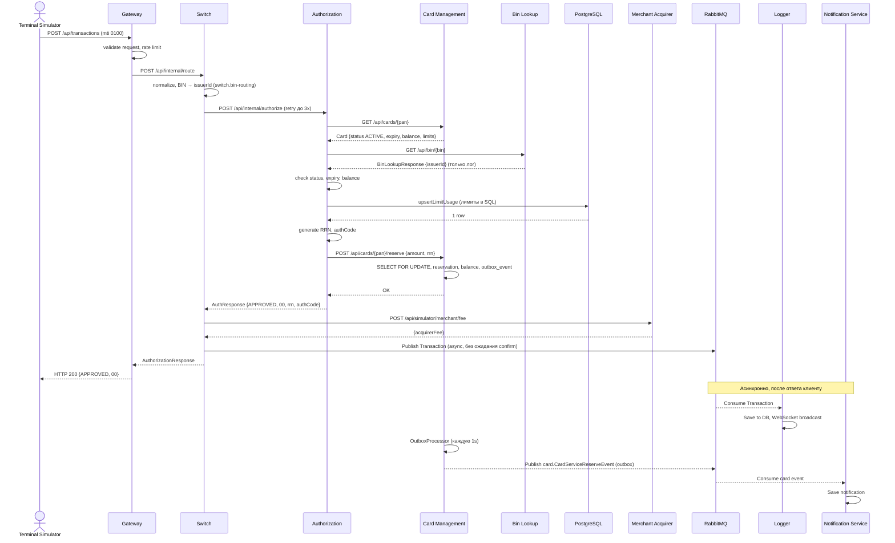
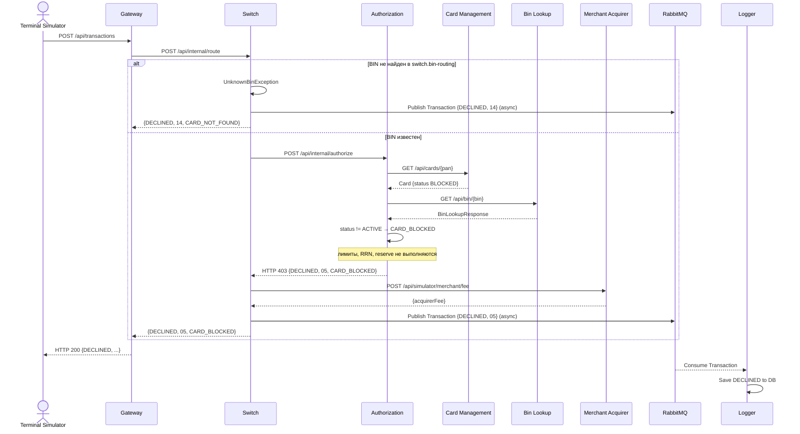
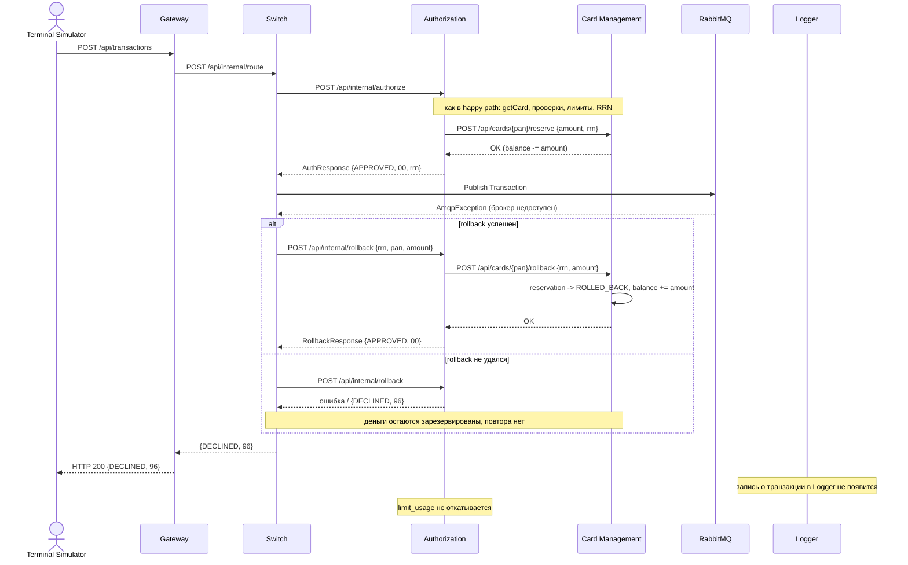

# А4. Sequence — путь транзакции

## Чего не хватало в проекте

Sequence в [`docs/architecture.md`](../../architecture.md) покрывает только happy
path и в нескольких местах расходится с кодом:

| # | В документации                                         | В коде                                                                                                                                                                                                                                         | Ссылка                                                                                                                                                                                                                                                                                                                                                                          |
|---|--------------------------------------------------------|------------------------------------------------------------------------------------------------------------------------------------------------------------------------------------------------------------------------------------------------|---------------------------------------------------------------------------------------------------------------------------------------------------------------------------------------------------------------------------------------------------------------------------------------------------------------------------------------------------------------------------------|
| 1 | Authorization сначала вызывает Bin Lookup, потом CMS   | сначала `getCard` в CMS, Bin Lookup только для найденной карты, результат не используется                                                                                                                                                      | [`AuthServiceImpl.java:46,66`](../../../services/authorization/src/main/java/com/processing/authorization/services/AuthServiceImpl.java)                                                                                                                                                                                                                                        |
| 2 | RRN генерируется после reserve                         | RRN генерируется до reserve, он нужен CMS как ключ резерва                                                                                                                                                                                     | [`AuthServiceImpl.java:149-151`](../../../services/authorization/src/main/java/com/processing/authorization/services/AuthServiceImpl.java)                                                                                                                                                                                                                                      |
| 3 | «Резервирование не атомарно, нужен SELECT FOR UPDATE»  | CMS уже берёт `PESSIMISTIC_WRITE` и повторно проверяет баланс в `startReservation`                                                                                                                                                             | [`CardJpaRepository.java:20`](../../../services/card-management/src/main/java/com/processing/cardmanagement/repositories/CardJpaRepository.java), [`Card.java:101`](../../../services/card-management/src/main/java/com/processing/cardmanagement/models/Card.java)                                                                                                             |
| 4 | Нет вызова Merchant Acquirer                           | после authorize Switch синхронно запрашивает комиссию                                                                                                                                                                                          | [`RouteService.java:70`](../../../services/switch/src/main/java/com/processing/service/RouteService.java)                                                                                                                                                                                                                                                                       |
| 5 | Нет проверки лимитов в БД                              | upsert `limit_usage` в PostgreSQL до reserve                                                                                                                                                                                                   | [`AuthServiceImpl.java:125`](../../../services/authorization/src/main/java/com/processing/authorization/services/AuthServiceImpl.java)                                                                                                                                                                                                                                          |
| 6 | Нет declined и reversal                                | см. сценарии 2 и 3 ниже                                                                                                                                                                                                                        | —                                                                                                                                                                                                                                                                                                                                                                               |
| 7 | Reversal «mti=0400, publisher confirm не пришёл за 2s» | MTI 0400 в коде нет (Gateway пропускает только `0100`). Откат — HTTP `POST /api/internal/rollback {rrn, pan, amount}`. Ожидания confirm с таймаутом 2s нет: rollback запускается только если `convertAndSend` синхронно бросил `AmqpException` | [`TransactionRequestValidator.java:37`](../../../services/gateway/src/main/java/com/processing/gateway/validation/TransactionRequestValidator.java), [`LoggerClient.java:40-49`](../../../services/switch/src/main/java/com/processing/service/LoggerClient.java), [`RouteService.java:85-91`](../../../services/switch/src/main/java/com/processing/service/RouteService.java) |

## Что сделано

Три сценария, восстановленные по коду. В каждом видно, где синхронный
вызов, где ответ клиенту и где начинается асинхронная «вилка».

---

## Сценарий 1. Happy path (APPROVED, `00`)

## Сценарий 2. Declined — карта BLOCKED (`05 CARD_BLOCKED`)

Наблюдение: Switch всегда отвечает `200`
([`RouteController.java:44`](../../../services/switch/src/main/java/com/processing/controller/RouteController.java)),
поэтому HTTP-статусы Authorization видны только во внутреннем контракте
Switch <-> Authorization. Клиенту отказ виден только по полям `status`/`responseCode`.

## Сценарий 3. Reversal — публикация в RabbitMQ не удалась (`96`)

Ветки компенсации (по коду [`RouteService.java:87-91`](../../../services/switch/src/main/java/com/processing/service/RouteService.java)
и [`AuthServiceImpl.java:223`](../../../services/authorization/src/main/java/com/processing/authorization/services/AuthServiceImpl.java)):