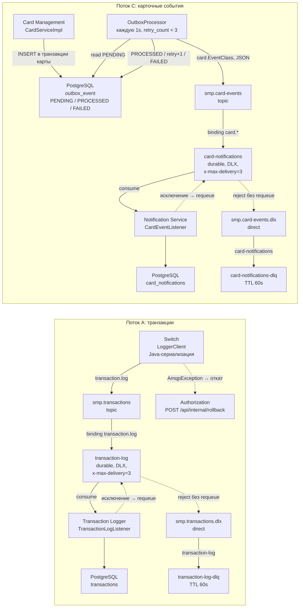

# А5. RabbitMQ-топология

## Чего не хватало в проекте

В [`docs/architecture.md`](../../architecture.md) («Сводная топология RabbitMQ»,
«Dead Letter Strategy», «Publisher Confirms») топология дана таблицей и текстом,
диаграммы нет.

| Механика (из документации)                          | Что в коде                                                                                                                                                                                                                                                                          | Вывод                                                                                                                                                                                                                                                                   |
|-----------------------------------------------------|-------------------------------------------------------------------------------------------------------------------------------------------------------------------------------------------------------------------------------------------------------------------------------------|-------------------------------------------------------------------------------------------------------------------------------------------------------------------------------------------------------------------------------------------------------------------------|
| Publisher confirms, таймаут 2s, при nack — reversal | `publisher-confirm-type: correlated` и `publisher-returns: true` есть, но `ConfirmCallback`, `ReturnsCallback` и `CorrelationData` нигде не используются. Число 2000 мс встречается только как `switch.http.logger-read-timeout-ms` (HTTP-таймаут к Logger, в коде не используется) | **частично не реализовано**: откат только по синхронному `AmqpException`                                                                                                                                                                                                |
| Retry: 3 попытки в consumer'е, затем DLQ            | аргумент очереди `x-max-delivery: 3`. В RabbitMQ такого аргумента нет: у quorum-очередей есть `x-delivery-limit`, а очереди classic. Retry-интерцептора в `spring.rabbitmq.listener` консьюмеров нет                                                                                | **не работает как описано**: при исключении в listener'е Spring по умолчанию делает requeue, и сообщение может бесконечно возвращаться в очередь. В DLX уходят только «фатальные» ошибки (например, `MessageConversionException`), которые Spring отклоняет без requeue |

Ссылки: [`switch application.yml:10-11,22`](../../../services/switch/src/main/resources/application.yml),
[`switch RabbitMQConfig.java:44-47,74-75`](../../../services/switch/src/main/java/com/processing/config/RabbitMQConfig.java),
[`card-management RabbitMQConfig.java:56-75,90`](../../../services/card-management/src/main/java/com/processing/cardmanagement/config/RabbitMQConfig.java),
[`OutboxProcessor.java:21`](../../../services/card-management/src/main/java/com/processing/cardmanagement/services/OutboxProcessor.java),
[`OutboxEventProcessorImpl.java:48`](../../../services/card-management/src/main/java/com/processing/cardmanagement/services/OutboxEventProcessorImpl.java),
[`application.properties:66-67`](../../../services/card-management/src/main/resources/application.properties).

## Что сделано

- Визуализирован путь сообщения для обоих потоков: producer -> exchange ->
  binding -> queue -> consumer -> БД, и ветка отказа DLX -> DLQ.
- На схеме отмечено, где механика работает по коду, а где существует
  только в документации.
- Указан формат сообщений.

## Диаграмма

## Таблица топологии 

| Exchange (тип)                  | Queue                    | Binding key          | Аргументы очереди              | Producer                       | Consumer                         | Код                                                                                                                                                                                                                                                                            |
|---------------------------------|--------------------------|----------------------|--------------------------------|--------------------------------|----------------------------------|--------------------------------------------------------------------------------------------------------------------------------------------------------------------------------------------------------------------------------------------------------------------------------|
| `smp.transactions` (topic)      | `transaction-log`        | `transaction.log`    | DLX, DL-RK, `x-max-delivery=3` | Switch `LoggerClient`          | Logger `TransactionLogListener`  | [Switch `RabbitMQConfig`](../../../services/switch/src/main/java/com/processing/config/RabbitMQConfig.java), [Logger `RabbitMQConfig`](../../../services/transaction-logger/src/main/java/com/processing/transactionlogger/config/RabbitMQConfig.java)                         |
| `smp.transactions.dlx` (direct) | `transaction-log-dlq`    | `transaction-log`    | TTL 60s                        | —                              | —                                | там же, [строки 64-86](../../../services/switch/src/main/java/com/processing/config/RabbitMQConfig.java)                                                                                                                                                                       |
| `smp.card-events` (topic)       | `card-notifications`     | `card.*`             | DLX, DL-RK, `x-max-delivery=3` | CMS `OutboxEventProcessorImpl` | Notification `CardEventListener` | [CMS `RabbitMQConfig`](../../../services/card-management/src/main/java/com/processing/cardmanagement/config/RabbitMQConfig.java), [Notification `RabbitMQConfig`](../../../services/notification-service/src/main/java/com/processing/notification/config/RabbitMQConfig.java) |
| `smp.card-events.dlx` (direct)  | `card-notifications-dlq` | `card-notifications` | TTL 60s                        | —                              | —                                | там же                                                                                                                                                                                                                                                                         |