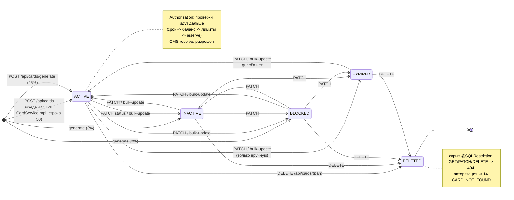
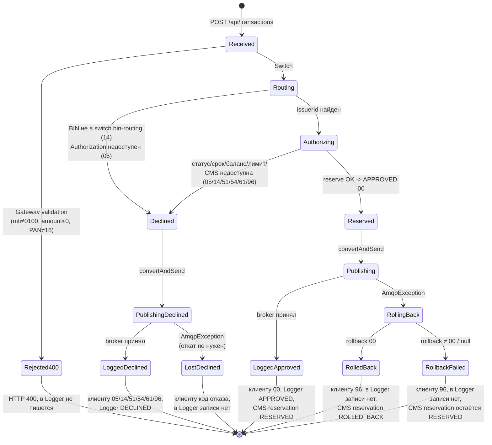

# А6. State-transition

## Чего не хватало в проекте

Диаграмм состояний нет.

## Что сделано

Построены три диаграммы:
1. `Card.status` — переходы и реакция системы на каждое состояние;
2. жизненный цикл транзакции;

## А6.1 Card.status

### Реакция системы на состояние

| Состояние                      | `GET /api/cards/{pan}` | Авторизация                          | `POST /{pan}/reserve`         | Код                                                                                                                                                                                                                                                                            |
|--------------------------------|------------------------|--------------------------------------|-------------------------------|--------------------------------------------------------------------------------------------------------------------------------------------------------------------------------------------------------------------------------------------------------------------------------|
| ACTIVE (срок не истёк)         | 200                    | дальше по проверкам, `00` при успехе | 200                           | [`AuthServiceImpl.java:77`](../../../services/authorization/src/main/java/com/processing/authorization/services/AuthServiceImpl.java)                                                                                                                                          |
| ACTIVE, `expiryDate` в прошлом | 200                    | `54 CARD_EXPIRED`                    | 200 (CMS срок не проверяет)   | [`AuthServiceImpl.java:108`](../../../services/authorization/src/main/java/com/processing/authorization/services/AuthServiceImpl.java), [`Card.java:101`](../../../services/card-management/src/main/java/com/processing/cardmanagement/models/Card.java)                      |
| INACTIVE                       | 200                    | `05 CARD_INACTIVE`                   | 409 (`IllegalStateException`) | [`Card.java:261`](../../../services/card-management/src/main/java/com/processing/cardmanagement/models/Card.java), [`GlobalExceptionHandler.java:98`](../../../services/card-management/src/main/java/com/processing/cardmanagement/configuration/GlobalExceptionHandler.java) |
| BLOCKED                        | 200                    | `05 CARD_BLOCKED`                    | 409                           | там же                                                                                                                                                                                                                                                                         |
| EXPIRED                        | 200                    | `54 CARD_EXPIRED`                    | 409                           | там же                                                                                                                                                                                                                                                                         |
| DELETED                        | 404                    | `14 CARD_NOT_FOUND`                  | 404                           | [`CardEntity.java:22`](../../../services/card-management/src/main/java/com/processing/cardmanagement/models/CardEntity.java)                                                                                                                                                   |

---

## А6.2 Жизненный цикл транзакции

